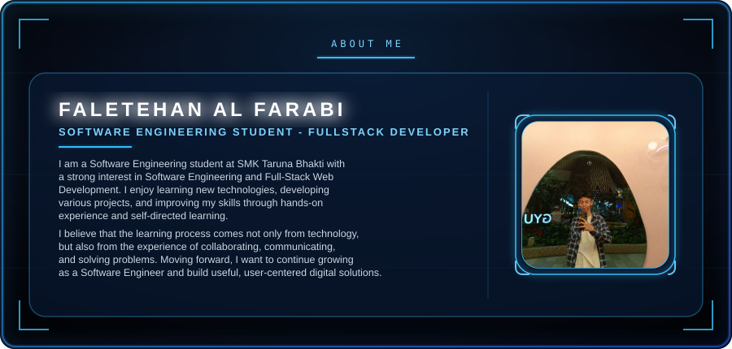
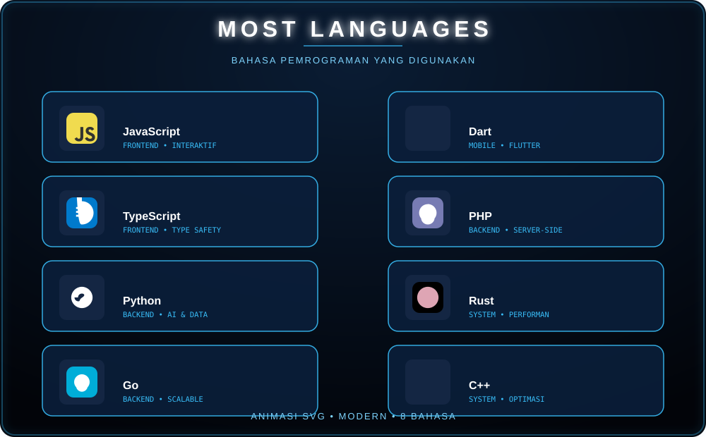

 

---

## About Me

Hi, I'm **Faletehan Al Farabi** — a Software Engineering student at **SMK Taruna Bhakti**,
focused on **Full-Stack Web Development**. I learn new technologies by building things,
and I care about solving problems through collaboration and clear communication.

| Detail | Information |
| :--- | :--- |
| **Role** | Software Engineering Student — Full-Stack Web Developer |
| **School** | SMK Taruna Bhakti |
| **Focus** | Full-Stack Web Development |
| **Core stack** | React, Next.js, TypeScript, Node.js, Tailwind CSS |
| **Status** | Open to work, collaborations, and internships |
| **Contact** | [faletehanalfarabi09@gmail.com](mailto:faletehanalfarabi09@gmail.com) |

---

## Tech Stack

**Frontend** — HTML, CSS, JavaScript, TypeScript, React, Next.js, Tailwind CSS, Vite, Vue, Flutter

**Backend & Database** — Node.js, Express, PHP, Laravel, Go, MySQL, PostgreSQL, MongoDB, SQLite, Supabase, Firebase

**Tools & Design** — Git, GitHub, GitLab, VS Code, Figma, Docker, Postman, Vercel, Netlify

---

## Most Languages

---

## GitHub Analytics

| GitHub Stats | Contribution Streak |
| :---: | :---: |
|  |  |

---

## Contribution Arcade

Consistency is the game. Every commit is progress.

<picture>
  <source media="(prefers-color-scheme: dark)" srcset="https://raw.githubusercontent.com/FaletehanAlF/FaletehanAlF/output/galaga-contribution-graph-dark.svg">
  <source media="(prefers-color-scheme: light)" srcset="https://raw.githubusercontent.com/FaletehanAlF/FaletehanAlF/output/galaga-contribution-graph.svg">
  
</picture>

---

## Let's Connect

I'm always open to interesting projects, collaborations, internships, and learning opportunities.

 

| Channel | Link |
| :--- | :--- |
| **LinkedIn** | [linkedin.com/in/faletehan-al-farabi-](https://www.linkedin.com/in/faletehan-al-farabi-) |
| **Email** | [faletehanalfarabi09@gmail.com](mailto:faletehanalfarabi09@gmail.com) |
| **YouTube** | [@444flthn](https://youtube.com/@444flthn) |
| **Instagram** | [@faalen_portofolio](https://www.instagram.com/faalen_portofolio/) |
| **Telegram** | [@faalenn](https://t.me/faalenn) |

 

  

